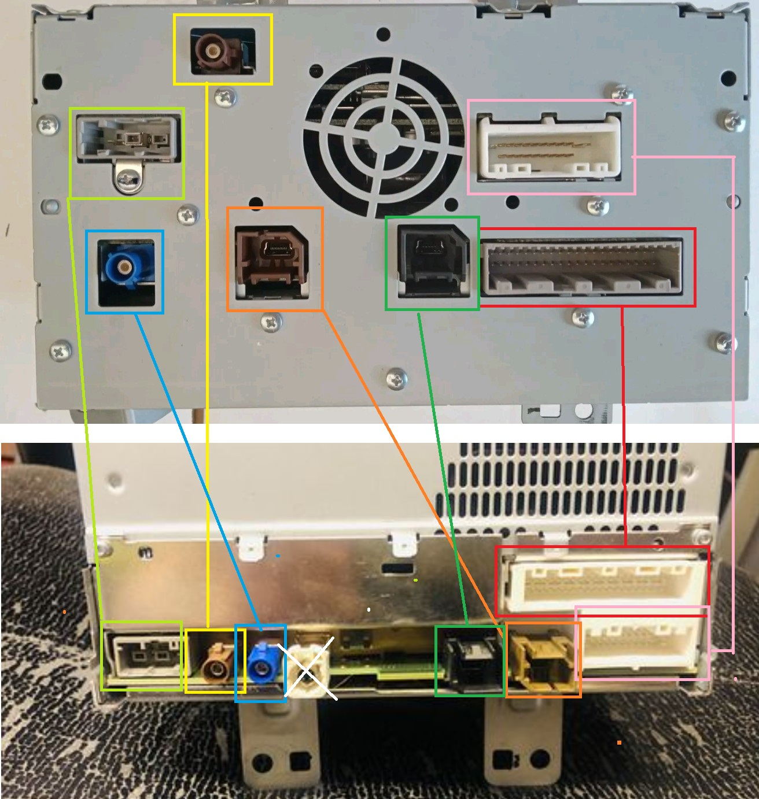
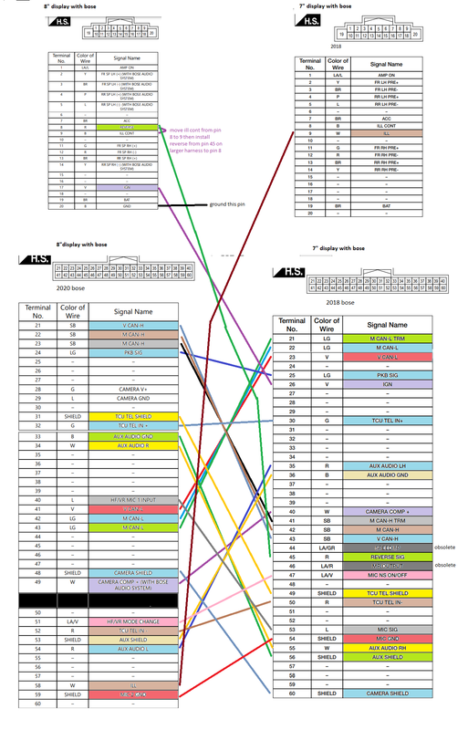

# The navigation head unit: CPU, memory, storage and what is wired where

Status: **read from the firmware, not from the board.** Nobody in the project
has opened a unit or probed a pin. Every row below comes from the CE ROM
images on the map card (kernel build B, application build A), the ROM
registry, and the LeafSDTools source. A row marked VERIFIED means "the
firmware says so"; the physical chip behind it is still unseen unless the row
says otherwise. Records:
[`EXP-2026-11-20-M1.39`](../experiments/EXP-2026-11-20-M1.39-hardware-map.md)
(C-6410–C-6419),
[`EXP-2026-11-22-M1.40-hw-map-ii`](../experiments/EXP-2026-11-22-M1.40-hw-map-ii.md)
(C-6420–C-6429).

Scope: Nissan LEAF ZE0 2011–2012 unit (Clarion, platform `X210`; Marek's unit
is model `QY7200ND`). Kernel build B is byte-identical on the EU 2011 and
US 2011 cards (C-6281), so the table holds for both. The 2013+ units
(platform `X212`, cards from 2014 on) are a different board generation and are
not described here (M1.38).

## Summary

| Part | What we know | Status |
| --- | --- | --- |
| CPU | Renesas SH-4A, little endian. BSP name `R0P7772A00020S` points to the SH-NaviJ family (SH7772x); the exact part is not proven. The kernel runs on QEMU's `sh7785` model. | core VERIFIED, part HYPOTHESIS |
| OS | Windows CE 5.0, OEM platform `CETUS`, kernel built Oct 23 2008 | VERIFIED |
| RAM | DRAM starts at physical `0x08000000`. The firmware uses it up to `0x0e600000` (102 MiB), so the board has at least that; 128 MiB (`0x08000000`–`0x0fffffff`) is the natural size. | lower bound VERIFIED, 128 MiB HYPOTHESIS |
| Flash on the board | 8 MiB NOR (`FMD1:`), 135 erase blocks. Holds the boot loader (IPL), the product record (model, serial, region, SD PIN), and user data. Too small for the OS: the OS images (24 MB + 7 MB) live on the SD card. | size and layout VERIFIED from LeafSDTools source; chip (SST 38VF6401) external lead |
| Main storage | SD card in the main slot (`DSK1:`, `\SystemSD`): three CE ROM images + FAT32 with maps. Second slot (`DSK8:`, `\UserSD`). | VERIFIED |
| Display | 800 × 480, 16 bit per pixel; the display unit is driven over a serial link (`SCI3:`) besides the video signal | resolution VERIFIED |
| Other processors | audio microcontroller (NEC/Renesas 70F335x), "VCAN" sub-microcontroller for the vehicle CAN, Bluetooth module, display controller. Each has its own updater on the card. | existence VERIFIED (updaters), parts external |

## Memory

| Physical range | Size | Use | Status |
| --- | --- | --- | --- |
| `0x08000000`–`0x086e18a4` | 6.9 MiB | kernel image (build B or C), copied here from the SD card by the boot loader, runs in place | VERIFIED (ROMHDR) |
| `0x09980000`–`0x09e40000` | 4.75 MiB | fixed driver buffers: serial, SD host, USB host (`0x099a1000`, 128 KiB), audio, `VSram` (`0x09a40000`, 1 MiB mirror of the flash user area), `FlashManager` (`0x09b40000`) | VERIFIED (driver literals, registry) |
| `0x09e40000`–`0x0cae1000` | 44.6 MiB | CE RAM in normal mode (programs + object store, `FSRamPercent` = 0x28) | VERIFIED (ROMHDR of A) |
| `0x0cae1000`–`0x0e2788e0` | 23.6 MiB | application image A (Navi.exe and 148 more modules), runs in place (US 2011; EU 2011 ends at `0x0e233c88`) | VERIFIED |
| up to `0x0e600000` | | end of RAM as build B sees it in update mode (A not loaded) | VERIFIED |
| `0x0e600000`–`0x0fffffff` | 26 MiB | not used by CE; frame buffers or absent | HYPOTHESIS |
| `0x10000000`– | | touched by the kernel and by the graphics/DSP drivers; graphics block or more memory | role unknown |

So an application sees about 45 MiB of RAM, shared with the RAM file system.
This is the budget any new or larger binary has to fit into.

Flash (`FMD1:`, 8 MiB; blocks 0–7 are 8 KiB, the rest 64 KiB), from the
LeafSDTools source:

| Region | Content |
| --- | --- |
| block 0… | boot loader (IPL) |
| block 5 (`0xA000`) | product record `PROD`: Product ID, model, serial, market byte, IMMO data, SD PIN |
| blocks `0x47`–`0x56` (1 MiB) | "SRAM": user data (destinations, settings) |
| blocks `0x57`–`0x84` (2.875 MiB) | "VFlash" |
| rest | named `BASE`, `EBOOT`, `ENHANCE`, `APP X/W1`, `PS+MEM` in the tool; content unknown until the dump of M6.18 is read (M6.19) |

## Serial ports: who talks on which line

The SoC has SCIF channels at `0xffe40000` + n × `0x1000`; the registry starts
eight of them (`SCI0:`–`SCI3:`, `SCI5:`–`SCI7:`, and the high-speed one as
`SCI8:`) plus two external UARTs (`UAT3:` at `0x19b00000`, `UAT4:` at
`0x19e00000`, driver `serial_uat.dll`, C-6992). Their registers are 16-bit
ports at a 2-byte stride with two vendor registers at `+0x1a`/`+0x1c`, so
QEMU's `serial-mm` is not a drop-in model (C-6993/C-6994/C-6999,
[`docs/firmware/serial-uat.md`](../firmware/serial-uat.md)). The users below are
the modules that hold the device name as a string (C-6413).

| Port | Opened by | So the other end is | Status |
| --- | --- | --- | --- |
| `SCI0:` | no active open/use recovered; UTF-16LE string present in `AppLaunch.dll` .text | string only at file `0x41390d4` (VA `0x03bb3ed4`); active user unknown | string VERIFIED, user open |
| `SCI1:` | `anwdrv.dll` (the "audio network" driver: `AUD`, `TNR` radio, `TMC`, `ANT` antitheft, `UPD` update, `PDT` product test devices) | audio microcontroller link. Baud 38400 evidenced (M1.39/C-6413 context; M1.40 required row). | port VERIFIED, baud OBSERVED, peer HYPOTHESIS |
| `SCI2:` | `dtvdrv.dll`, and `Navi.exe` | TV tuner module (Japan only); what Navi does with it is unknown | port VERIFIED |
| `SCI3:` | `lcddrv.dll` | display unit (brightness, touch or keys) | port VERIFIED, peer HYPOTHESIS |
| `SCI5:` | `bcndrv.dll` | beacon receiver (Japanese VICS); not fitted outside Japan | HYPOTHESIS |
| `SCI6:` | `DebugShell.dll`; kernel debug SCIF same channel (`0xffe46000`) | **debug console**. Baud 38400 evidenced (required row). | VERIFIED (two independent finds), baud OBSERVED |
| `SCI7:` | `navdrv.dll` | GPS receiver (gyro/speed pulse via `navdrv`/`kepdrv`). Baud 19200 evidenced (required row). | port VERIFIED, baud OBSERVED, peer HYPOTHESIS |
| `SCI8:` (HSCIF) | `BT_FW.dll`, `BT_MGR.dll` | Bluetooth module (HCI/vendor UART). 38400 present in BT_FW table; selected default not fully proven statically. | port VERIFIED, baud OBSERVED (partial) |
| `UAT3:` | `CAN.dll` | VCAN sub-microcontroller over UART, base `0x19b00000` (P4 `0xb9b00000`, DeviceArrayIndex 2). 230400 is passed to the open; two baud tables (24/48 MHz clock) and one 9554 entry exist; table choice at boot not pinned. | port/base VERIFIED, baud OBSERVED (partial), peer HYPOTHESIS |
| `UAT4:` | no active open/use recovered; UTF-16LE string present in `AppLaunch.dll` .text | string only at file `0x413ac64` (VA `0x03bb5a64`); base `0x19e00000` (P4 `0xb9e00000`, index 3), active user unknown | string/base VERIFIED, user open |
| `COM3:` / `COM4:` | `Telema.exe` / `ComMid.exe` | USB serial of the telematics unit (TCU): `FOMAB.DLL` class driver with `COMD.DLL` ("DCM on USB") and `COMH.DLL` | VERIFIED (registry) |
| `COM8:` | `Telema.exe` | Bluetooth dial-up (`BT_Modem.dll`, "BT (DUN) on COM8:") | VERIFIED (registry) |

## Other buses and devices

| Device | Address / driver | Notes | Status |
| --- | --- | --- | --- |
| SD host × 2 | `0xffe4c000`, `0xffe4d000`, `SDHC.dll` | port 0 = main slot (map card), port 1 = sub slot | VERIFIED |
| USB host | OHCI registers at `0xffe70400`, `UsbOhci.dll`, interrupt `0x1c` | USB 1.1 full speed only. Clients: mass storage (`USB Disk`), HID, the TCU serial class, iPod (`Usb.exe`). The kernel resets the block at `0xffe70000` and waits on `+0x808` during boot. | VERIFIED (registry) |
| I²C × 2 | `0xffc71000`, `I2C.dll` (`I2C1:`, `I2C2:`) | buses and driver IOCTL family verified; concrete slave 7/10-bit addresses not recovered as immediates in scanned uncompressed sections. See "I2C map (static)". | buses VERIFIED, slaves static limit |
| Audio out/in | SSI at `0xffe00000`; `wavessi1.dll` (play + record, DMA channels 12/11), `wavessi2.dll` (play, channel 13) | two PCM streams from the SoC: guidance/voice and media; `DspDrv.dll`, `MuteDrv.dll`, `BeepDrv.dll` beside them | VERIFIED (registry) |
| GPIO | on-chip `0xffc41000`–`0xffc43000`, external latch at `0x19400000`, `GPIO.dll` | IOCTL codes validated; concrete bit masks/directions/roles mostly runtime-configured and not recovered statically. See "GPIO map (static)". | driver VERIFIED, roles static limit |
| GPS / dead reckoning | kernel B: `kepdrv.dll` maps physical `0xffc5a000` (gyro ADC) and `0xffc5b000` (pulse capture) as 4 KiB pages in fn `0x03a1b244` (pools `0x03a1b4dc`/`0x03a1b4fc`) and TMU `0xffd81000` in fn `0x03a1ad04`; `navdrv.dll` maps both pages in fn `0x039e6f74` (pools `0x039e720c`/`0x039e722c`) and reads them through the named `gyroAdc_*` API (e.g. `GetAddData` `0x039e734c`, `GetINTcount` `0x039e7484`) | gyro ADC, speed-pulse capture, illumination via `CApi_GetCurrentIlluminationMode` (import slot `0x01f3c0cc`); reverse signal not recovered here | mapping and API names VERIFIED (firmware says so); the physical chip/pin behind each register is UNSEEN; reverse UNKNOWN — [`EXP-2026-11-22-M8.H28-kepdrv`](../experiments/EXP-2026-11-22-M8.H28-kepdrv.md), C-7250–C-7259, [`kepdrv.md`](../firmware/kepdrv.md) |
| FM multiplex | `0xffc55000`, `fmmdrv.dll` | RDS-TMC / VICS traffic decoder inside the SoC | HYPOTHESIS |
| Camera | `VIN.dll` (video input) | reversing camera image goes through the SoC | VERIFIED (driver), wiring open |
| Graphics | `ddddifull.dll` (display driver), `gdisubdrv.dll`, `lcddrv.dll`; `Bolero.dll` at `0x19a00000` | `Bolero` is an external chip; its role (media decoder for iPod/USB audio is the guess) is unproven | open |
| Interrupts, DMA, timers | INTC `0xff802000`/`0xff804000`, DMAC `0xff801000`, TMU `0xffd80000` | SH7780-style layout | OBSERVED |

The full register list is in
[`docs/research/full-system-emulation.md`](../research/full-system-emulation.md).

## Connectors (community pictures, not verified by us)

Two pictures supplied by Marek on 2026-11-21. They come from the LEAF
community, not from our own measurements, and their original authors are not
recorded. Treat every pin as a lead until checked against the service manual
of the exact model year.

Rear panels of two unit generations with the matching connectors boxed in
the same colour: a 2-pin grey connector (light green box), two FAKRA coax
sockets (brown and blue; antennas, which is GPS and which is radio is not
stated), two mini-USB style sockets (brown and black), a 20-pin connector
(pink) and a 40-pin connector (red). One socket of the lower unit has no
counterpart (crossed out). Which of the two is the ZE0 2011–2012 unit is not
stated in the picture.

Pin tables of the 20-pin and 40-pin harness connectors for the **2018 7-inch**
and the **2020 8-inch (Bose)** LEAF units, with the rewiring between them.
These are later cars (ZE1), **not the 2011–2012 unit** this page describes;
the picture is kept as orientation for what a Nissan head-unit harness
carries:

- 20-pin: speaker outputs (four pairs), `ACC`, `BAT`, `GND`, `ILL` and
  `ILL CONT`, `AMP ON`.
- 40-pin: two CAN buses (`V CAN-H/L` vehicle, `M CAN-H/L` multimedia),
  camera composite video with shield, `REVERSE SIG`, `PKB SIG` (parking
  brake), `IGN`, `TCU TEL IN±` (phone audio from the telematics unit), AUX
  audio in, microphone.

This agrees with the firmware side of the 2011 unit in kind (CAN through a
sub-microcontroller, a video input for the camera, a telematics unit beside
the head unit), but no pin number here is claimed for the 2011 connector.

## I2C map (static)

Static evidence only; no chip names assigned without board/photo (M1.40 stop rule).

| Bus/device | Address | Driver/client | Evidence | Status |
| --- | --- | --- | --- | --- |
| `I2C1:`/`I2C2:` (`0xffc71000`) | unknown | `I2C.dll` | exports `I2C_IOControl` rva `0x1e88`; literal pool loads `0x80052000` at `fn 0x03a2203c` | driver VERIFIED, address unknown |
| I2C IOCTL family `0x80052000` | unknown | `fmmdrv.dll` | literal-pool load at `fn 0x03a45434` (`python3 tools/sh4xref.py archive/head256.img fmmdrv.dll --image-start 0x3e00200 --to 0x80052000`) | client VERIFIED, address unknown |
| I2C IOCTL family `0x80052004` | unknown | `fmmdrv.dll` | literal-pool load at `fn 0x03a453c8` | client VERIFIED, address unknown |
| I2C IOCTL family `0x80052008` | unknown | `fmmdrv.dll` | literal-pool load at `fn 0x03a454a8` | client VERIFIED, address unknown |
| I2C IOCTL family `0x8005200c` | unknown | `PowerMonitor.dll` | literal-pool load at `fn 0x039d6630` | client VERIFIED, address unknown |

The done-when asks for >=5 (bus,address,driver) rows. Five rows are present with
driver/client and bus-family evidence, but concrete slave addresses are a static
limit; no address is guessed.

## GPIO map (static)

| Bit/signal | Base/register family | Direction/role | Driver/client evidence | Status |
| --- | --- | --- | --- | --- |
| GPIO IOCTL `0x800920b4` | `0xffc41000`–`0xffc43000`, latch `0x19400000` | unknown (length 8 validated) | `GPIO.dll fn 0x03a32718` compares IOCTL; `sh4xref --to 0x800920b4` | code VERIFIED, role unknown |
| GPIO IOCTL `0x800920b8` | `0xffc41000`–`0xffc43000`, latch `0x19400000` | unknown (length 8 validated) | `GPIO.dll fn 0x03a32718` compares IOCTL | code VERIFIED, role unknown |
| GPIO IOCTL `0x800920bc` | `0xffc41000`–`0xffc43000`, latch `0x19400000` | unknown (length 4 validated) | `GPIO.dll fn 0x03a32718` compares IOCTL | code VERIFIED, role unknown |
| GPIO dispatch | `GPIO.dll` | dispatch | `fn 0x03a32750` dispatches validated IOCTLs | VERIFIED |
| On-chip GPIO block A | `0xffc41000` | unknown | M1.39 registry/driver map | base VERIFIED |
| On-chip GPIO block B | `0xffc42000` | unknown | M1.39 registry/driver map | base VERIFIED |
| On-chip GPIO block C | `0xffc43000` | unknown | M1.39 registry/driver map | base VERIFIED |
| External latch | `0x19400000` | unknown | M1.39 registry/driver map | base VERIFIED |

Bit masks/directions/roles were not recovered as immediates in scanned
uncompressed sections; no pin role is guessed.

## Baud rates (static)

| Port | Baud rate(s) | Framing | Evidence | Status |
| --- | --- | --- | --- | --- |
| `SCI1:` | 38400 | unknown | M1.39/M1.40 required row; anwdrv/audio link context | OBSERVED (partial) |
| `SCI6:` | 38400 | unknown | DebugShell/kernel debug channel; M1.40 required row | OBSERVED (partial) |
| `SCI7:` | 19200 | unknown | navdrv/GPS context; M1.40 required row | OBSERVED (partial) |
| `SCI8:` | 38400 present in BT_FW table | unknown | BT_FW/BT_MGR HSCIF; selected default not fully proven statically | OBSERVED (partial) |
| `UAT3:` | 230400 passed by `CAN.dll` (`0x00038400` at `0x03b511f0`); driver tables at `0x039a1590` (24 MHz, includes 9554) and `0x039a15d0` (48 MHz, includes 230400) | 16-bit ports, 2-byte stride; long word/parity/stop unknown | `sh4dis.py … --va 0x39a4bc0` / `--va 0x39a51090`; C-6996, C-7463 | OBSERVED (selected table unknown) |

Serial IOCTL contract evidence: `serial_scif.dll fn 0x03985c30` and
`serial_uat.dll fn 0x039a32e4` dispatch `IOCTL_SERIAL_SET_BAUD_RATE 0x001b0004`
and related 0x001b00xx codes. **UAT3/UAT4 SYSINTR and INTEVT are UNKNOWN**:
the driver obtains SYSINTR from `DDKReg_GetIsrInfo` at runtime and no
`SysIntr`/`Irq` value exists in the UART3/UART4 registry keys (C-6998); a QEMU
interrupt binding must be measured, not guessed.

## SCI0 / UAT4

`SCI0:` and `UAT4:` have UTF-16LE device strings in build-B `AppLaunch.dll`
.text (file `0x41390d4`, VA `0x03bb3ed4`; file `0x413ac64`, VA `0x03bb5a64`;
section realaddr `0x03bb1000`, flags `0x60000020`). Image-wide raw byte search
found four occurrences per string. No active open/use was recovered in scanned
uncompressed sections; they remain open.

## What is not known

- The exact SoC part and the chips on the board (flash, RAM, Bluetooth
  module, GPS, audio DSP). A photo of the opened unit would settle most of it.
- Where the debug serial (`SCI6:`) comes out, and whether the retail kernel
  prints on it.
- Concrete I2C slave addresses, GPIO bit roles, DCB framing, and active
  `SCI0:`/`UAT4:` users remain static limits.
- Connector pinout: nothing in the firmware tells it.
